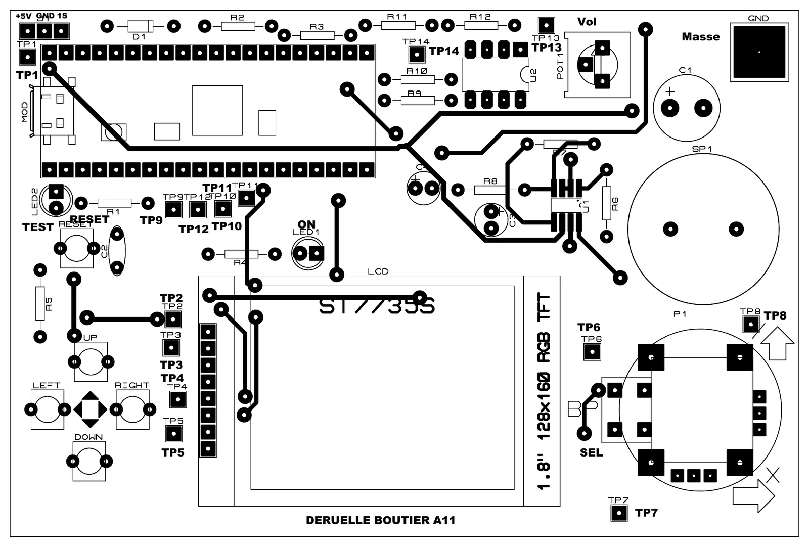
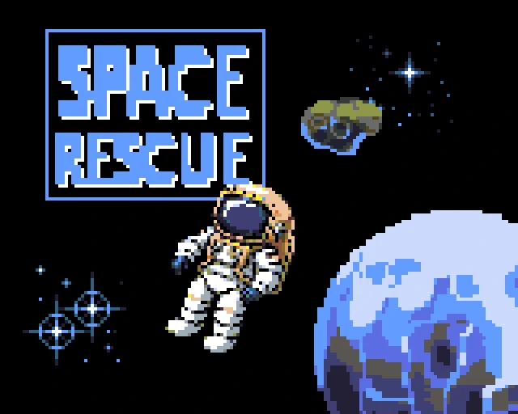
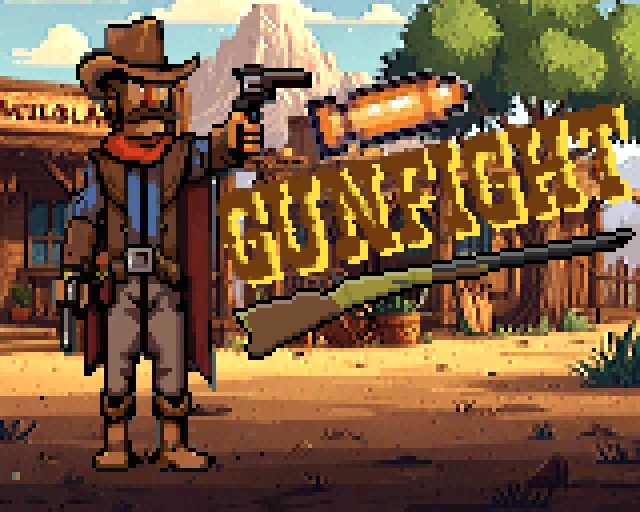
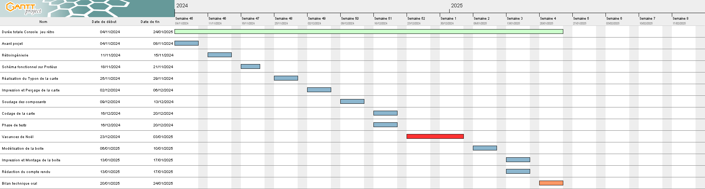

<a id="top"></a>
# Pico Retro Handheld — console de jeu rétrogaming portable

**[🇫🇷 Français](#francais) · [🇬🇧 English](#english)**



---

<a id="francais"></a>
## 🇫🇷 Français

> Une console de jeu portable conçue de A à Z : la carte électronique sous Proteus, sa fabrication (tirage, perçage, soudure), un boîtier imprimé en 3D, puis trois jeux programmés en CircuitPython sur Raspberry Pi Pico.

**Contexte :** projet universitaire (SAÉ 2), BUT GEII — IUT de Rennes, novembre 2024 – janvier 2025
**Équipe :** Bouttier & Deruelle
**Stack :** Raspberry Pi Pico · CircuitPython 9 · écran TFT ST7735S 1,8″ (SPI) · Proteus

### Le sujet

Réaliser une carte électronique avec les fonctionnalités de base d'une console de rétrogaming, en offrant la possibilité de créer ses propres jeux. Le projet faisait suite à l'analyse de la carte de la « fabrique à histoires » de Lunii.

### Le matériel

| Élément | Détail | Broches (Pico) |
|---|---|---|
| Écran | TFT ST7735S 1,8″, 160 × 128, bus SPI | SCK GP10 · MOSI GP11 · MISO GP12 · CS GP13 · RES GP14 · DC GP15 |
| Joystick | analogique 2 axes + bouton (start) | X GP26 · Y GP27 · bouton GP22 |
| Croix directionnelle | 4 boutons haut / bas / gauche / droite | GP6 · GP7 · GP8 · GP9 |
| Son | haut-parleur en PWM, volume réglable par potentiomètre | GP16 · GP21 |
| Divers | LED de test, bouton reset | GP4 · GP0 |

Fichiers de conception dans [`cao/`](cao/) : projet Proteus (`console_retro.pdsprj`), schéma d'implantation, nomenclature et routage (`routage.svg`).

### Les jeux

| Space Rescue | Gunfight | Christmas Pong |
|---|---|---|
|  |  |  |
| Premier jeu, réalisé en suivant le tutoriel de prise en main : affichage, déplacements, collisions, animation, boutons, joystick et bruitages. | Duel à deux joueurs inspiré de *Gun Fight* (Sega, 1969) et *Western Gun* (Taito, 1975). Quatre écrans : titre, règles, jeu, fin. | Hommage au *Pong* d'Atari (1972) dans une ambiance de Noël : match à deux joueurs, scores, collisions balle / raquettes. Quatre écrans : titre, règles, jeu, fin. |

Pour Gunfight et Christmas Pong, aucun code n'était fourni : chaque jeu a été écrit de A à Z à partir des règles et des ressources graphiques et sonores mises à disposition.

### Organisation du dépôt

```
├── code/
│   ├── lib/                 Bibliothèques partagées (Adafruit, contrôles, ressources des jeux)
│   ├── Spacerescue/         code.py + images/ + audio/
│   ├── Gunfight/            code.py + images/ + audio/
│   └── Christmas_pong/      code.py + images/ + audio/
├── cao/                     Projet Proteus, schéma d'implantation, nomenclature, routage
├── docs/images/             Captures utilisées dans ce README
└── *.pdf                    Analyse fonctionnelle, carte mentale, sujets de la SAÉ
```

### Lancer un jeu

1. Installer CircuitPython 9 (ou plus récent) sur la Raspberry Pi Pico.
2. Copier le dossier `code/lib/` dans le dossier `lib/` du lecteur `CIRCUITPY`.
3. Copier le contenu du dossier du jeu choisi (`code.py`, `images/`, `audio/`) à la racine de `CIRCUITPY`.
4. Le jeu démarre automatiquement.

> ⚠️ Space Rescue a besoin du module `Ressources_tutoriel.py`, fourni avec le tutoriel et absent de ce dépôt.

### Planning



Avant-projet et rétro-ingénierie, schéma fonctionnel sous Proteus, typon, impression et perçage, soudure, code et tests, modélisation puis impression et montage du boîtier, compte rendu et bilan technique oral.

### Crédits

- Conception de la carte, fabrication et code des jeux : Bouttier & Deruelle.
- Sujets, ressources graphiques et sonores, et modules `Ressources_*` / `Gestion_controles` : équipe pédagogique du département GEII de l'IUT de Rennes (Michaël Bottin).
- Bibliothèques Adafruit CircuitPython (licence MIT).

[⬆ Retour en haut](#top)

---

<a id="english"></a>
## 🇬🇧 English

> A handheld game console built from scratch: circuit board designed in Proteus, made in-house (printing, drilling, soldering), a 3D-printed case, then three games written in CircuitPython on a Raspberry Pi Pico.

**Context:** university project (SAÉ 2), BUT GEII — IUT de Rennes, November 2024 – January 2025
**Team:** Bouttier & Deruelle
**Stack:** Raspberry Pi Pico · CircuitPython 9 · 1.8″ ST7735S TFT screen (SPI) · Proteus

### The brief

Build a circuit board with the basic features of a retro gaming console, with the ability to create your own games. The project followed a study of the circuit board of Lunii's "fabrique à histoires" storyteller.

### Hardware

| Part | Details | Pins (Pico) |
|---|---|---|
| Screen | 1.8″ ST7735S TFT, 160 × 128, SPI bus | SCK GP10 · MOSI GP11 · MISO GP12 · CS GP13 · RES GP14 · DC GP15 |
| Joystick | 2-axis analog + button (start) | X GP26 · Y GP27 · button GP22 |
| D-pad | 4 buttons up / down / left / right | GP6 · GP7 · GP8 · GP9 |
| Sound | PWM speaker, volume set by a potentiometer | GP16 · GP21 |
| Misc. | test LED, reset button | GP4 · GP0 |

Design files in [`cao/`](cao/): Proteus project (`console_retro.pdsprj`), component layout, bill of materials and routing (`routage.svg`).

### Games

| Space Rescue | Gunfight | Christmas Pong |
|---|---|---|
|  |  |  |
| First game, built while following the getting-started tutorial: display, movement, collisions, animation, buttons, joystick and sound effects. | Two-player duel inspired by *Gun Fight* (Sega, 1969) and *Western Gun* (Taito, 1975). Four screens: title, rules, game, end. | A tribute to Atari's *Pong* (1972) with a Christmas theme: two-player match, scores, ball / paddle collisions. Four screens: title, rules, game, end. |

For Gunfight and Christmas Pong, no code was provided: each game was written from scratch from the rules and the supplied graphics and sound assets.

### Run a game

1. Install CircuitPython 9 (or newer) on the Raspberry Pi Pico.
2. Copy `code/lib/` into the `lib/` folder of the `CIRCUITPY` drive.
3. Copy the chosen game folder's content (`code.py`, `images/`, `audio/`) to the root of `CIRCUITPY`.
4. The game starts automatically.

> ⚠️ Space Rescue needs the `Ressources_tutoriel.py` module, supplied with the tutorial and missing from this repository.

### Credits

- Board design, manufacturing and game code: Bouttier & Deruelle.
- Briefs, graphics and sound assets, and the `Ressources_*` / `Gestion_controles` modules: GEII teaching staff, IUT de Rennes (Michaël Bottin).
- Adafruit CircuitPython libraries (MIT licence).

[⬆ Back to top](#top)
